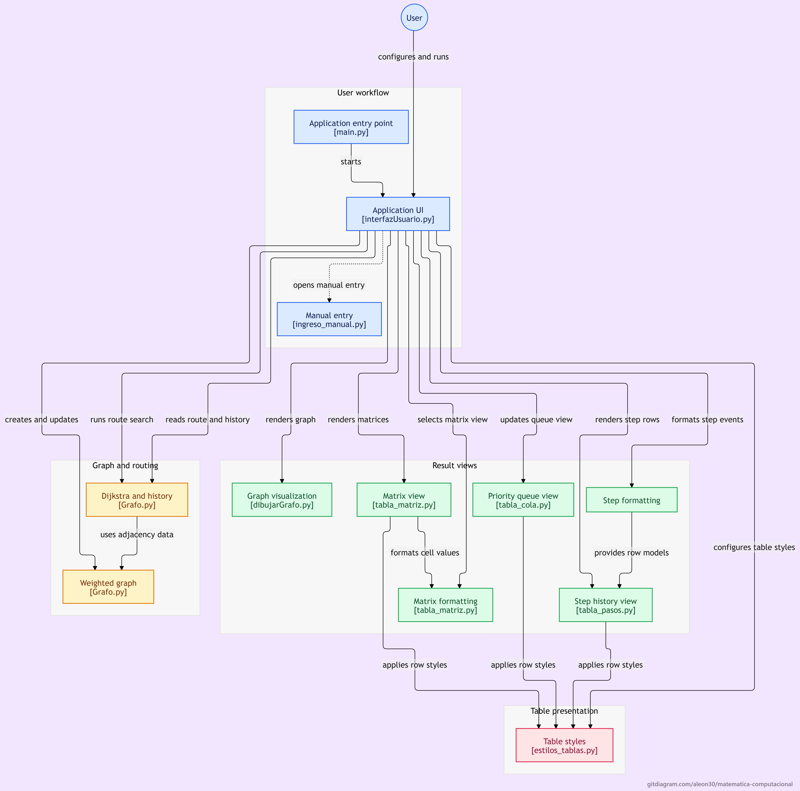

# Matemática Computacional 💻 - TB1


## 👥 Integrantes

| Integrante | Aportes |
| --- | --- |
| Cóndor Velásquez, Angela Bibiana | Redacción de la introducción y desarrollo del marco teórico, la teoría de grafos y su aplicación en problemas de caminos mínimos. Formulación teórica del algoritmo de Dijkstra y explicación de su funcionamiento paso a paso. |
| Horna Cueva, Carlos Orlando Frank | Aplicaciones del proyecto, diseño de la interfaz visual e implementación de las matrices de pesos, adyacencia y caminos, así como del paso a paso de Dijkstra en la interfaz. |
| Leon Ojeda, Adrian Alejandro | Creación de la clase `Grafo`, implementación de Dijkstra en Python y visualización del grafo con Matplotlib y NetworkX. |
| Quispe Laura, Johan Micael | Redacción de la introducción, planteamiento del problema, explicación de la teoría de grafos y justificación del algoritmo de Dijkstra. |
| Sedano Barreda, Luis Enrique | Desarrollo del marco teórico y formulación y explicación del cálculo del camino mínimo y del algoritmo de Dijkstra. |

## 📝 Descripción

**Caso 2: Problema del camino mínimo**

FastRoute es una aplicación de escritorio en Python que encuentra el camino de menor costo entre dos vértices de un grafo no dirigido y ponderado mediante el algoritmo de Dijkstra.

La aplicación permite crear grafos de entre 5 y 15 vértices de dos maneras:

- **Automática:** genera conexiones aleatorias con pesos enteros positivos entre 1 y 50.
- **Manual / Caso real:** permite editar una matriz de pesos simétrica o cargar un archivo JSON de caso de estudio. Las celdas vacías representan la ausencia de una conexión y la diagonal se mantiene en cero.

Después de crear el grafo, se puede explorar su dibujo, consultar las matrices de pesos, de adyacencia y de caminos, elegir el origen y el destino, y ver la ruta y su costo total. La interfaz también presenta el desarrollo del algoritmo, la cola de prioridad y controles para avanzar o retroceder por cada paso.

## 🚀 Instalación y ejecución

Se requiere **Python 3.11 o posterior**. Desde la carpeta del proyecto, instala las dependencias y ejecuta la aplicación:

```bash
python -m pip install -r requirements.txt
python main.py
```

En Windows también puedes usar el lanzador `py`:

```powershell
py -m pip install -r requirements.txt
py main.py
```

La interfaz utiliza Tkinter, que normalmente está incluido con Python. Las dependencias externas son:

| Librería | Versión requerida | Uso |
| --- | --- | --- |
| `networkx` | `>= 3.4.2` | Representación del grafo y cálculo de conectividad. |
| `matplotlib` | `>= 3.10.0` | Dibujo del grafo integrado en la interfaz. |

## 📂 Casos de estudio JSON

El modo manual permite cargar un archivo `.json` con el siguiente formato:

```json
{
  "empresa": "Nombre del caso",
  "cantidadVertices": 5,
  "nombresNodos": ["Origen", "Nodo 1", "Nodo 2", "Nodo 3", "Destino"],
  "conexiones": [
    { "origen": 0, "destino": 1, "peso": 12 },
    { "origen": 1, "destino": 4, "peso": 8 }
  ]
}
```

Los índices de los vértices empiezan en `0`; la cantidad debe estar entre 5 y 15 y cada conexión debe tener un peso entero positivo. El proyecto incluye dos ejemplos que puedes seleccionar al cargar un caso:

- [`CasoReal.json`](CasoReal.json): red de distribución regional de Transporexa, con 6 vértices.
- [`caso_estudio_logistica (Prueba).json`](<caso_estudio_logistica (Prueba).json>): red logística Lima–Chancay, con 7 vértices.

## 🗂️ Estructura del proyecto

```text
Matematica-Computacional/
├── assets/
│   ├── diagrama_flujo.png
│   └── logo.jpg
├── CasoReal.json
├── caso_estudio_logistica (Prueba).json
├── Grafo.py
├── dibujarGrafo.py
├── estilos_tablas.py
├── estrategias_tablas.py
├── ingreso_manual.py
├── interfazUsuario.py
├── main.py
├── requirements.txt
├── tabla_cola.py
├── tabla_matriz.py
├── tabla_pasos.py
├── README.md
└── .gitignore
```

### Módulos principales

| Archivo | Responsabilidad |
| --- | --- |
| `main.py` | Crea la ventana principal e inicia la aplicación. |
| `interfazUsuario.py` | Orquesta la interfaz, generación de grafos, selección de nodos y visualización de resultados. |
| `Grafo.py` | Modelo del grafo, matrices y algoritmo de Dijkstra con historial de pasos. |
| `ingreso_manual.py` | Edición de conexiones y carga/validación de casos JSON. |
| `dibujarGrafo.py` | Dibuja el grafo y resalta nodos, aristas y la ruta mínima. |
| `tabla_matriz.py` | Presenta las matrices de pesos, adyacencia y caminos. |
| `tabla_cola.py` | Presenta el estado de la cola de prioridad durante el algoritmo. |
| `tabla_pasos.py` | Presenta los eventos del algoritmo paso a paso. |
| `estrategias_tablas.py` | Define los formatos de fila para los distintos eventos de Dijkstra. |
| `estilos_tablas.py` | Centraliza estilos y etiquetas visuales de las tablas. |
| `requirements.txt` | Lista las dependencias externas del proyecto. |
| `.gitignore` | Excluye archivos de caché de Python y configuración local de VS Code. |

## 🔀 Diagrama de flujo



## 📃 Ensayo escrito

[Consultar el ensayo del proyecto](https://docs.google.com/document/d/1fkgKkOlmoDAklxEF-dcQPGk53CMKxI-PJQ0BN2SKPco/edit?usp=sharing)
